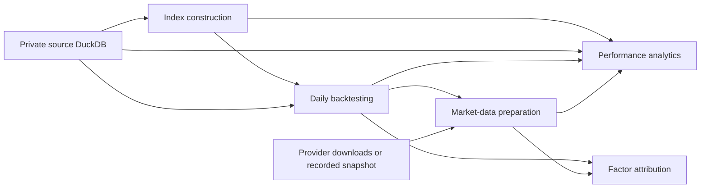

# S&P 500 Top 10 Concentration Research


[](https://github.com/M-Gamal0/SP500-Top10-Concentration-Research/actions/workflows/checks.yml)

A modular Python research pipeline for constructing and evaluating concentrated S&P 500 portfolios. It combines quarterly company selection, daily price-return and total-return backtesting, performance and risk analysis, and factor attribution in one reproducible workflow.

The project compares three Top 10 weighting strategies and a Top 20 robustness portfolio against the S&P 500. The default historical configuration spans **December 31, 1998 to August 31, 2026**, with an initial index value of **1,000**. A complete run produces **50 analytical tables and 38 CSV reports**.

**Data availability:** historical constituent, company, and stock data come from a private database built using paid data. That database and its preparation notebooks are not distributed. The public repository starts at index construction and includes a deterministic synthetic demonstration that runs without private data or network access.

> Research and demonstration only. Backtested results are hypothetical and depend on the supplied data and modeling assumptions; they are not investment advice or a forecast of future returns.

[Quick start](#quick-start) · [Methodology](#strategy-methodology) · [Analytics](#analytics-and-factor-attribution) · [Outputs](#outputs) · [Architecture](#project-structure) · [Validation](#quality-and-validation)

---

## Overview

The workflow is designed to investigate how concentration, portfolio construction, and factor exposure affect index performance:

- **Four portfolios:** Top 10 market cap, Top 10 equal weight, Top 10 buffered-cap market cap, and Top 20 market cap.
- **Daily simulation:** separate price-return and total-return index levels, price-driven weight drift, quarterly rebalances, and monthly concentration reviews for the capped strategy.
- **Performance analysis:** absolute and relative drawdowns, trailing and rolling returns, historical episodes, market/style regimes, turnover, and transaction-cost sensitivity.
- **Attribution:** quarterly company and sector contributions, rolling factor exposures, and CAPM, FF3, FF5, and FF5 plus momentum comparisons.
- **Reproducibility:** central configuration, a read-only source database, separate calculated results, recorded provider snapshots, and validated stage prerequisites.
- **Report-ready data:** numeric result tables and CSV layouts suitable for further analysis, charts, and presentations.

The production application uses ordinary Python modules. It does not depend on Jupyter cell execution or notebook state.

## Quick Start

### 1. Install

Use Python 3.13 or newer. The historical compatibility checks were performed with Python 3.13.5 on Windows.

```bash
git clone https://github.com/M-Gamal0/SP500-Top10-Concentration-Research.git
cd SP500-Top10-Concentration-Research

python -m venv .venv
source .venv/Scripts/activate       # Windows / Git Bash
# source .venv/bin/activate         # macOS / Linux

python -m pip install -e ".[dev]"
```

If the project environment already exists, activate it and use the commands below. Direct dependencies are pinned in [pyproject.toml](pyproject.toml); [requirements-lock.txt](requirements-lock.txt) records the full original Windows research environment.

### 2. Run the public demonstration

```bash
python examples/create_synthetic.py --destination .local/synthetic
python run.py --root .local/synthetic --offline
```

This creates fictional company histories and provider snapshots, then executes all five stages. Results are written under `.local/synthetic/data/`, `.local/synthetic/outputs/`, and `.local/synthetic/logs/`.

The synthetic values demonstrate software behavior; they are not historical investment results. The generator refuses to overwrite an existing source database. To repeat the calculation, rerun the second command. To create a new demonstration dataset, choose another destination.

### 3. Run with your own compatible private database

Place the prepared source at `data/sp500.duckdb`, or set `SP500_SOURCE_DB` to its location. The source must contain the tables described under [Data and Reproducibility](#data-and-reproducibility).

```bash
# Refresh benchmarks, risk-free rates, and factor data, then run all stages.
python run.py

# Reuse an existing recorded provider snapshot without network requests.
python run.py --offline
```

Online mode downloads the supplementary market data; it does not build the private company universe or download the constituent stock database. Offline mode requires an existing compatible snapshot under `cache/market_data/`. Neither the private database nor its historical snapshot is included in a fresh clone.

### Common commands

| Command | Purpose |
|---|---|
| `python run.py` | Run the full workflow with a provider refresh |
| `python run.py --offline` | Run the full workflow using a recorded snapshot |
| `python run.py --stage construction` | Build quarterly portfolio targets |
| `python run.py --stage backtesting` | Simulate daily index levels, weights, and rebalance events |
| `python run.py --stage market-data --offline` | Load and validate the recorded provider tables |
| `python run.py --stage analytics` | Generate the 28 analytics tables and CSVs |
| `python run.py --stage factor-attribution` | Generate the 10 factor-attribution tables and CSVs |
| `python run.py --help` | Show available command-line options |

Individual stages require compatible upstream results. They do not silently rerun prerequisites. Changes to source data, calculation settings, code, or recorded upstream results can require rebuilding earlier stages. The full workflow is the simplest way to rebuild a consistent result set.

## Strategy Methodology

### Universe and quarterly selection

The pipeline begins with a prepared quarterly company universe. On each selection date, it excludes unresolved market capitalizations, ranks eligible companies by descending `resolved_marketcap`, and uses ticker order to break ties. It selects the Top 10 for the core strategies and the Top 20 for robustness analysis.

The market-cap measure is the resolved company value supplied by the private preparation stage. It is not presented as a free-float weight reconstructed from ETF filings.

| Portfolio | Internal identifier | Quarterly target weights | Additional review |
|---|---|---|---|
| Top 10 market cap | `top_n=10`, `market_cap` | Selected company market cap divided by selected total market cap | None |
| Top 10 equal weight | `top_n=10`, `equal_weight` | 10% per selected company | None |
| Top 10 buffered market cap | `top_n=10`, `buffered_20` | Market-cap weights with iterative 18% caps | Month-end 20% breach review |
| Top 20 market cap | `top_n=20`, `market_cap` | Selected company market cap divided by selected total market cap | None |

The legacy report labels are `MC`, `EW`, and `MC (UCITS)` for the three core portfolios. `MC (UCITS)` identifies the implemented concentration overlay; it is not a certification of regulatory compliance.

### Buffered-cap strategy

At quarterly rebalances, weights above 18% are capped and excess weight is redistributed proportionally among uncapped constituents. The process repeats until weights sum to 100% and satisfy the caps.

At each month-end trading date:

1. Review the portfolio's drifted ending weights.
2. If any weight is strictly above 20%, schedule an 18% capped reset for the next trading date.
3. Keep the existing basket for a monthly reset; constituent changes occur at quarterly rebalances.
4. Give a quarterly rebalance precedence if it coincides with a scheduled monthly reset.

### Daily backtest mechanics

- **Timing:** quarterly selections become effective on the first available trading date strictly after the selection date. The initial base observation is the preceding trading date.
- **Calendar:** valid trading dates are derived from representative stock histories using the configured coverage threshold, currently 90%.
- **Price return:** calculated from the source `close` series.
- **Total return:** calculated from the source `closeadj` series, retaining the source data's adjustment conventions.
- **Weight drift:** both index streams use the same beginning weights; ending weights drift using price returns.
- **Input continuity:** required holding periods must have complete price and adjusted-price observations. Incomplete histories fail validation.
- **Turnover:** one-way turnover is half the sum of absolute changes from drifted pre-rebalance weights to target weights across the union of holdings. Initial establishment is excluded.

For each return stream, the index compounds as:

```text
Portfolio return = sum(beginning weight × constituent return)
Index level      = previous index level × (1 + portfolio return)
One-way turnover = 0.5 × sum(|target weight − pre-rebalance weight|)
```

The baseline indices are gross of trading costs. A separate sensitivity analysis applies scenarios from 0 to 50 basis points, in 5-basis-point steps, to one-way turnover:

```text
Net daily growth factor = (1 + daily return) × (1 − one-way turnover × cost rate)
```

## Analytics and Factor Attribution

### Performance, risk, and construction

| Analysis | Coverage |
|---|---|
| Growth and returns | Growth of 1,000; full-period, trailing, calendar-year, and historical-episode returns |
| Rolling comparisons | Five- and ten-year CAGR-gap distributions, win frequencies, and rolling five-year relative performance |
| Drawdowns | Absolute drawdowns, benchmark-relative drawdowns, recovery, and underperformance duration |
| Risk metrics | Volatility, Sharpe, Sortino, Calmar, beta, CAPM alpha, tracking error, information ratio, correlation, capture ratios, skewness, and excess kurtosis |
| Concentration and holdings | Monthly Top 10 market-cap concentration, first/latest holdings, and quarterly sector allocation |
| Construction sensitivity | Market cap versus equal weight versus capped weights; trading-cost scenarios; Top 10 versus Top 20 |
| Market and style regimes | Monthly up/neutral/down market states crossed with value-led/neutral/growth-led style states |

Quarterly company and sector attribution links daily contributions through subsequent returns so they reconcile to the compounded quarterly portfolio return. The attribution reports also identify how much of a quarter's return came from the leading contributors.

### Factor research

The factor stage combines monthly portfolio and benchmark returns with Fama–French factors and momentum:

- **36-month rolling exposures:** FF3 estimates and HML confidence intervals for the market-cap portfolio and S&P 500.
- **Recent-period attribution:** decomposition of active returns over the most recent 120 common monthly observations.
- **60-month rolling persistence:** factor-adjusted alpha, statistical significance, and the persistence of active performance.
- **Model robustness:** CAPM, FF3, FF5, and FF5 plus momentum comparisons, including strategy-level comparisons.
- **Style context:** growth/value leadership and its relationship to the selected comparison periods.

Regression inference uses heteroskedasticity- and autocorrelation-consistent standard errors with three lags. Exposure regressions use excess returns; active-return regressions use strategy minus benchmark directly. Monthly alpha is annualized by multiplying by 12.

The analytics FF3 sample and the factor-attribution common sample are deliberately distinct. Factor availability can produce an earlier sample end than the daily backtest; the application preserves those intersections rather than filling unavailable factor observations.

## Data and Reproducibility

| Input | Use | Availability |
|---|---|---|
| Prepared quarterly company universe | Membership, ranking, resolved market cap, and selection metadata | Private source database |
| Historical stock prices and company metadata | Daily returns, market-cap concentration, and sectors | Private source database |
| Yahoo Finance `^GSPC` and `^SP500TR` | S&P 500 price-return and total-return benchmarks | Downloaded through `yfinance` |
| FRED `DGS3MO` | Three-month Treasury risk-free proxy | Downloaded CSV |
| Kenneth French data library | FF3, FF5, momentum, and size/book-to-market style portfolios | Downloaded ZIP/CSV files |
| Deterministic fictional inputs | Public demonstration and automated tests | Generated locally |

FRED observations are aligned backward to the trading calendar. The daily risk-free return retains the research convention `annual rate percent / 100 / 252`.

The source database must contain these tables and columns:

| Table | Required columns |
|---|---|
| `quarterly_company_universe` | `selection_date`, `ticker`, `name`, `resolved_marketcap`, `marketcap_source`, `multi_class_company` |
| `stocks` | `date`, `ticker`, `close`, `closeadj` |
| `sp500` | `date`, `action`, `ticker`, `name` |
| `daily` | `date`, `ticker`, `marketcap` |
| `tickers` | `ticker`, `sector`, `lastupdated` |

Matching column names alone is insufficient: inputs must also satisfy the stage-specific coverage, uniqueness, and calculation checks. Preparation of these tables is outside the public workflow.

### Online and offline inputs

An online run records retrieved provider payloads locally and saves normalized provider tables as a checksummed offline snapshot. Provider failures raise errors instead of silently falling back to cached data. Subsequent offline runs validate snapshot integrity, configuration, and coverage.

If an existing local database already contains the six normalized provider tables, a snapshot can be captured explicitly:

```bash
python tools/capture_market_snapshot.py --source "C:/path/to/database.duckdb"
```

This tool refuses to overwrite an existing snapshot and records that the inputs came from normalized database tables. Historical provider revisions can change an online run's results; comparisons against the original research use fixed offline inputs.

## Outputs

The application attaches the source database read-only and writes calculated results to a separate DuckDB file.

| Stage | Result tables | CSV reports |
|---|---:|---:|
| Index construction | 1 | 0 |
| Daily backtesting | 5 | 0 |
| Market-data preparation | 6 | 0 |
| Performance analytics | 28 | 28 |
| Factor attribution | 10 | 10 |
| **Total** | **50** | **38** |

Execution metadata is stored separately from these 50 analytical tables.

```text
data/
├── sp500.duckdb                    # Private input; read-only to the application
└── sp500_results.duckdb            # Calculated tables and execution metadata

outputs/
├── analytics/                     # 28 CSV reports
│   ├── growth_1000_full_period.csv
│   ├── absolute_drawdown_summary.csv
│   ├── construction_summary.csv
│   ├── transaction_cost_sensitivity.csv
│   └── ...
└── factor_attribution/             # 10 CSV reports
    ├── active_return_regression_by_period.csv
    ├── recent_factor_attribution.csv
    ├── rolling_factor_adjusted_performance.csv
    └── ...

cache/                             # Provider payloads and normalized snapshots
logs/                              # Per-run status, configuration, and coverage
```

CSVs use UTF-8 with BOM, no index column, `YYYY-MM-DD` dates, and empty fields for missing values. The complete filename registry, ordered headers, units, and pivot conventions are documented in the [CSV output contract](docs/CSV_OUTPUT_CONTRACT.md). CSV layouts can differ from their underlying numeric database tables.

Outputs and databases remain local by default. The pipeline exports tables and chart data; it does not generate an Excel workbook or presentation deck.

## Project Structure

```text
SP500-Top10-Concentration-Research/
├── run.py                         # Single entry point
├── pyproject.toml                 # Package metadata and direct dependencies
├── requirements-lock.txt          # Original research environment versions
├── .github/workflows/checks.yml   # Windows/Linux checks using synthetic data
├── src/sp500_top10/
│   ├── app.py                     # Command-line arguments and logging
│   ├── config.py                  # Central calculation settings and paths
│   ├── pipeline.py                # Stage order, prerequisites, and persistence
│   ├── run_context.py             # Run manifests and input/code identities
│   ├── data/                      # Database adapter and 30 packaged SQL resources
│   ├── construction/              # Ranking, selection, weighting, and caps
│   ├── backtesting/               # Calendar, prices, rebalancing, and simulation
│   ├── market_data/               # Providers, alignment, and offline snapshots
│   ├── analytics/                 # Performance, risk, regimes, and contributions
│   ├── factors/                   # Exposures, regressions, and factor attribution
│   └── reporting/                 # Output registry and verified CSV exports
├── examples/create_synthetic.py   # Public demonstration data generator
├── notebooks/exploration.ipynb    # Optional consumer of the production package
├── tests/                         # Calculation, provider, and operational tests
├── tools/                         # Snapshot capture, compatibility, and recovery
└── docs/                          # Architecture, output contract, and verification
```

The stage dependencies are:



Market-data preparation uses the backtest calendar. Factor attribution depends on backtesting and market data, so it can run independently of the analytics stage once those prerequisites are valid.

The numerical stack is **pandas**, **NumPy**, and **statsmodels**, with **DuckDB** for persistence and SQL, **yfinance** for benchmark downloads, and **Ruff** for lint and formatting.

## Configuration and Operation

Calculation settings live in [src/sp500_top10/config.py](src/sp500_top10/config.py), grouped into construction, backtesting, market data, analytics, and factors. Important defaults include the 18% reset cap, 20% breach threshold, 1,000 initial index level, historical dates, rolling windows, and regression settings.

Paths resolve from the project root, independently of the shell's working directory. Environment variables override the ignored `.local/paths.json` profile and built-in defaults:

| Variable | Default |
|---|---|
| `SP500_SOURCE_DB` | `data/sp500.duckdb` |
| `SP500_RESULTS_DB` | `data/sp500_results.duckdb` |
| `SP500_OUTPUT_ROOT` | `outputs` |
| `SP500_CACHE_ROOT` | `cache` |
| `SP500_LOG_ROOT` | `logs` |

```bash
export SP500_SOURCE_DB="C:/path/to/private/sp500.duckdb"
python run.py --offline
```

Use Windows-compatible absolute paths on Windows, or paths relative to the project root. When moving the project, retain the required private inputs and snapshots, update any explicit path overrides, and recreate the environment if its location changes.

The supported report set is the four portfolios above. Changing dates also requires reviewing historical episodes, snapshot labels, and available factor history; arbitrary Top-N or date configurations are not guaranteed to produce the existing reports.

### Persistence and recovery

Each stage writes its tables transactionally and records completion status. Downstream stages verify configuration, code and source identities, and the contents of required upstream tables. Failed runs return a nonzero exit code and retain a local run record.

CSV sets are validated before replacement, with backups and a completion marker. An interrupted export blocks another publication until recovered:

```bash
python tools/recover_csv_publication.py outputs/analytics
# Or use outputs/factor_attribution for that report set.
```

After recovery, rerun the affected stage. Individual CSV replacements are recoverable, but replacing an entire collection is not one atomic filesystem operation.

### Optional exploration

The [exploration notebook](notebooks/exploration.ipynb) imports the production package and reads calculated results. Before launching your notebook environment from Git Bash, set:

```bash
export SP500_PROJECT_ROOT="$(pwd -W)"   # Windows / Git Bash
# export SP500_PROJECT_ROOT="$PWD"    # macOS / Linux
```

Select the project environment as the notebook kernel. Clear saved outputs before publishing notebook changes that might contain private records.

## Quality and Validation

The [GitHub Actions workflow](.github/workflows/checks.yml) is configured for Windows and Linux on pushes and pull requests. It runs Ruff lint and formatting checks, the test suite, and the complete synthetic offline workflow.

Run the code checks locally:

```bash
PYTHONPATH=src python -m unittest discover -s tests -v
ruff check src run.py tools examples tests
ruff format --check src run.py tools examples tests
```

The 17-test suite covers numerical examples, cap and date boundaries, price-driven weight drift, contribution linking, provider parsing and retries, read-only source protection, database rollback, CSV recovery, modified upstream results, corrupted snapshots, and relocation to a path containing spaces.

### Historical compatibility

The module migration was verified against a frozen private reference:

| Check | Verified result |
|---|---|
| Analytical tables | All 50 matched, including database schemas |
| CSV reports | All 38 matched, including column and row ordering |
| Byte-level CSV comparison | 37 identical; one concentration report had small floating-point differences |
| Numerical comparison | Combined absolute and relative tolerances of `1e-12` |
| Original inputs | Source database and all eight original notebooks retained their checksums |
| Portability | Repository relocation, independent package import, and packaged SQL resources checked |

With the private reference and original notebooks available locally:

```bash
python tools/verify_compatibility.py
```

This check requires materials excluded from the public repository. It establishes compatibility with saved research results; it does not independently certify the investment methodology. See [verification details](docs/VERIFICATION.md) for the comparison limits and floating-point diagnostics. Live provider refreshes were not part of the historical compatibility run.

## Methodology Notes and Limitations

- **Private research inputs:** public users can reproduce the synthetic workflow; reproducing the historical analysis requires compatible licensed inputs and the relevant provider snapshot.
- **Source conventions matter:** universe preparation, resolved market capitalization, adjusted prices, and corporate-action treatment are inherited from the supplied database. The runtime does not reconstruct those inputs.
- **Research scope:** the capped strategy models the stated 18%/20% concentration rules. The legacy `MC (UCITS)` label does not establish full fund-level compliance.
- **Execution assumptions:** the baseline does not model a live execution process, taxes, financing, liquidity constraints, or market impact. The turnover-based cost scenarios are a separate sensitivity analysis.
- **Metadata and coverage:** sector attribution uses the selected company metadata rather than a separately reconstructed point-in-time sector history. Concentration coverage can extend beyond the daily backtest, and factor samples depend on common available observations.
- **Preserved legacy behavior:** the monthly-reset counter's `monthly_20_35` versus `monthly_20` label mismatch remains documented and unchanged for compatibility. Revisit it as a separate methodology/reporting change.
- **Interpretation:** statistical significance and historical outperformance do not establish persistence or causation. The project is research software, not a live trading service or official index calculation agent.

## Further Documentation

| Document | Purpose |
|---|---|
| [Architecture](docs/ARCHITECTURE.md) | Stage responsibilities, interfaces, preserved conventions, and configuration |
| [CSV output contract](docs/CSV_OUTPUT_CONTRACT.md) | All 38 filenames, ordered headers, and report-layout requirements |
| [Verification](docs/VERIFICATION.md) | Historical comparisons, operational checks, and known limits |
| [Public release notes](docs/PUBLIC_RELEASE.md) | Boundaries between publishable code and local research material |

## Author

**Mohammed Gamal**

[LinkedIn](https://www.linkedin.com/in/mohammed-gamal0/) · [GitHub](https://github.com/M-Gamal0)
