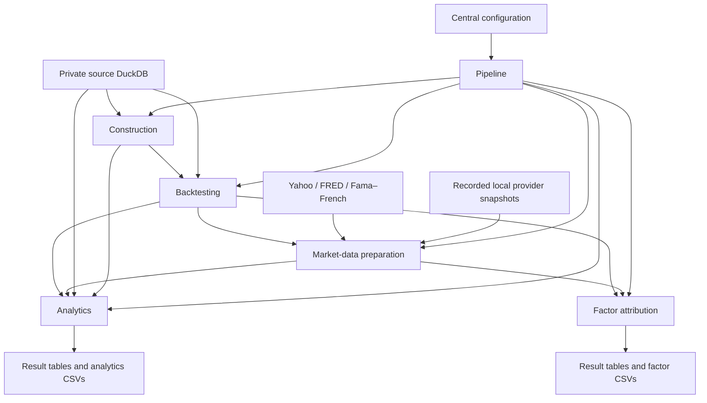

# S&P 500 Top 10: production architecture

Status: implemented, relocated to the repository root, and verified locally. See [verification](VERIFICATION.md), [relocation verification](RELOCATION.md), and [saved checkpoints](IMPLEMENTATION_PROGRESS.md). GitHub publication remains deferred.

Prepared from the code in notebooks 03–07 and read-only inspection of the existing DuckDB database and CSV inventory. Notebook 08 is schema reference only.

## 1. Agreed requirements

- Run the complete project from one file in Git Bash: `python run.py`.
- Keep optional notebooks for exploration, using the same Python functions as production.
- Rebuild the responsibilities in notebooks 03–07 into focused modules.
- Preserve the existing methodology, calculation conventions, validation checks, and output behavior during the rebuild. Methodology changes and bug fixes belong to a separate later change.
- Preserve all 38 CSV outputs: 28 analytics files and 10 factor-attribution files, including filenames, directories, column order, units, row ordering, formatting, and missing-value conventions.
- Centralize user-adjustable settings in `config.py`.
- Make the finished project relocatable: no committed machine-specific absolute paths, and no dependency on the current repository's parent-folder name or shell working directory.
- Use the existing Python 3.13 environment for development and initial comparison.
- Keep the database and private preparation stages out of GitHub. Local development and verification may use the private database.
- Leave notebooks 01, 02, and 08 outside production conversion. Preserve the original notebooks during migration.

## 2. Architecture decision

The implemented system is a single installable Python package with a thin entry file, explicit stage orchestration, dedicated database and provider adapters, calculation modules, and separate reporting adapters.

The first version is a local batch application. It does not require a web service, scheduler, distributed execution, plugin framework, or database server.

### User workflow

Optional editable installation for development (the root runner also works directly):

```bash
source .venv/Scripts/activate
python -m pip install -e '.[dev]'
```

Normal execution from the project directory:

```bash
python run.py
```

Optional operational controls:

```bash
python run.py --stage construction
python run.py --stage backtesting
python run.py --stage market-data
python run.py --stage analytics
python run.py --stage factor-attribution
python run.py --offline
```

`--stage` runs only the named stage and checks that required inputs exist and are compatible. It does not silently rerun other stages. `--offline` uses explicitly recorded local market-data snapshots; it fails clearly if required snapshots are missing. Default full execution includes market-data downloads, matching the notebook workflow.

The documented command is `python`, which resolves to the activated virtual environment on this Windows installation. No separate `python3` installation is required.

### Entry file responsibilities

`run.py` calls `sp500_top10.app.main()` under a main guard. It contains no SQL, portfolio logic, analysis formulas, or export transformations.

`app.py` parses the small set of operational arguments, loads configuration, starts logging, invokes the pipeline, and returns an appropriate process exit code. It does not suppress errors or report success after an incomplete run.

## 3. Dependency flow



The default sequence is construction, backtesting, market-data preparation, analytics, then factor attribution. Factor attribution does not depend on analytics outputs. Market-data preparation currently needs the backtest calendar, so its position after backtesting is intentional.

Only orchestration imports across stages. Analytics and factor-attribution calculation modules may share low-level mathematical helpers, but neither imports the other's stage implementation or notebook state.

## 4. Implemented repository structure

The repository root is the application root. `data/database.py` owns source and result access and source-column contracts; `data/results.py` defines stage results; `data/sql_resources.py` loads 30 packaged SQL files. Capping lives in `construction/weighting.py`, turnover in the backtest engine and assembly, and provider alignment in dedicated benchmark, risk-free, factor, and style modules. Analytics and factors split calculations and validations by report family. Report layouts remain beside their calculation family, with the shared registry and publication mechanism under `reporting/`.

The executable synthetic example is `examples/create_synthetic.py`; tests are `tests/test_calculations.py`, `tests/test_operations.py`, and `tests/test_providers.py`. The optional notebook is `notebooks/exploration.ipynb`. There are no placeholder abstraction layers.

```text
project/
├── run.py
├── pyproject.toml
├── requirements-lock.txt
├── README.md
├── .gitignore
├── .github/workflows/checks.yml
├── src/sp500_top10/
│   ├── __init__.py
│   ├── app.py
│   ├── config.py
│   ├── pipeline.py
│   ├── run_context.py
│   ├── data/
│   │   ├── database.py
│   │   ├── results.py
│   │   ├── sql_resources.py
│   │   └── sql/
│   ├── construction/
│   │   ├── stage.py
│   │   ├── selection.py
│   │   ├── weighting.py
│   │   ├── portfolios.py
│   │   ├── ranking.py
│   │   ├── output.py
│   │   └── validation.py
│   ├── backtesting/
│   │   ├── stage.py
│   │   ├── calendar.py
│   │   ├── prices.py
│   │   ├── rebalancing.py
│   │   ├── engine.py
│   │   ├── assembly.py
│   │   ├── inputs.py
│   │   └── validation.py
│   ├── market_data/
│   │   ├── stage.py
│   │   ├── yahoo.py
│   │   ├── fred.py
│   │   ├── french.py
│   │   ├── benchmarks.py
│   │   ├── risk_free.py
│   │   ├── factors.py
│   │   ├── style.py
│   │   ├── snapshot.py
│   │   ├── transport.py
│   │   └── validation.py
│   ├── analytics/
│   │   ├── stage.py
│   │   ├── concentration.py
│   │   ├── holdings.py
│   │   ├── growth.py
│   │   ├── period_returns.py
│   │   ├── rolling_returns.py
│   │   ├── rolling_distribution.py
│   │   ├── drawdowns.py
│   │   ├── historical_periods.py
│   │   ├── regimes.py
│   │   ├── construction_comparison.py
│   │   ├── cost_sensitivity.py
│   │   ├── robustness.py
│   │   ├── component_attribution.py
│   │   ├── risk_metrics.py
│   │   └── validation.py
│   ├── factors/
│   │   ├── stage.py
│   │   ├── samples.py
│   │   ├── regression_comparison.py
│   │   ├── exposure.py
│   │   ├── attribution.py
│   │   ├── persistence.py
│   │   ├── model_comparison.py
│   │   ├── strategy_comparison.py
│   │   └── style_environment.py
│   └── reporting/
│       ├── catalog.py
│       └── csv_export.py
├── notebooks/exploration.ipynb
├── examples/create_synthetic.py
├── tests/
│   ├── test_calculations.py
│   ├── test_operations.py
│   └── test_providers.py
├── tools/
│   ├── capture_market_snapshot.py
│   ├── freeze_reference.py
│   ├── recover_csv_publication.py
│   └── verify_compatibility.py
└── docs/
    ├── ARCHITECTURE.md
    ├── CSV_OUTPUT_CONTRACT.md
    ├── VERIFICATION.md
    └── RELOCATION.md
```

These boundaries describe responsibilities, not a target file count. A small cohesive component can remain in one file. Do not add empty abstraction layers or miscellaneous `utils.py` collections. Longer SQL statements belong in named SQL resources packaged with the application; short queries may stay in the relevant repository method.

The original research notebooks remain locally at the repository root and are excluded from Git. Equivalence has been established against the frozen reference. The optional exploration notebook is a thin consumer of package functions and calculated results; it is not a second implementation.

## 5. Module responsibilities and interfaces

| Area | Responsibilities | Boundary |
|---|---|---|
| Configuration | Defaults, typed settings, path resolution, validation | No database access or calculations at import time |
| Pipeline | Stage order, prerequisites, run status, publication | No financial formulas |
| Data | SQL, connections, input contracts, result persistence | No reporting layout or portfolio methodology |
| Construction | Rank, select, weight, cap, validate targets | Accept frames and settings; return targets and diagnostics |
| Backtesting | Calendar, price returns, rebalance state, daily simulation, turnover | Accept explicit inputs; return five result frames |
| Market data | Download or load snapshots, parse, normalize, align, validate | Network access confined to provider adapters |
| Analytics | Descriptive performance, risk, regimes, costs, robustness, component attribution | Calculations return numeric results |
| Factors | Sample preparation, regressions, exposure, factor attribution, comparisons | Explicit sample policy and regression settings |
| Reporting | Exact legacy layouts, file registry, CSV writing and verification | No recalculation of portfolio methodology |

Use small typed result containers for construction and backtesting outputs. For the larger analysis stages, use a named result bundle with an explicit output registry and validation of required names. DataFrame contracts define columns, keys, ordering, units, and date semantics; type hints alone do not define a DataFrame schema.

Calculation functions receive the relevant settings object and input frames. They do not read mutable global settings, open database connections, download data, call `display()`, or write files. Each `stage.py` coordinates loading, computation, validation, and persistence for its responsibility.

Extract shared capping and regression primitives only after comparing both notebook implementations. Sharing a primitive must not change the caller's sample, defaults, tolerances, or behavior.

## 6. Centralized configuration

`config.py` contains immutable typed dataclasses, current defaults, and a single `load_config()` entry point. Group settings as follows:

| Settings group | Current behavior to represent |
|---|---|
| Paths | Private source DB, result DB, provider cache, analytics directory, factor directory, log directory |
| Construction | Four portfolio specifications; Top 10 and Top 20; 18% caps; current tolerances |
| Backtest | Initial index 1,000; end date 2026-08-31; calendar coverage 90%; month-end 20% breach checks and 18% resets |
| Market data | Start 1998-12-31; end 2026-08-31; two benchmark tickers; DGS3MO; 30-day risk-free lookback; source URLs; 252 trading days |
| Analytics | Snapshot dates; trailing and rolling windows; historical episode definitions; market thresholds ±2%; style thresholds ±1%; transaction costs 0–50 bps in steps of 5 |
| Factors | Exposure window 36 observations; recent window 120; rolling active window 60; HAC lags 3; confidence and significance conventions |
| Reporting | Strategy labels, orders, UTF-8 BOM, date format, missing-value representation |
| Execution | Selected stages, online/offline mode, logging level |

Resolve the project root from the entry file's location and pass it explicitly into configuration loading. Resolve relative path settings against that root, never the shell's current working directory. Exploration notebooks supply an explicit project root rather than assuming their launch directory. Do not commit a user's absolute path.

The finished project's portable defaults are `data/sp500.duckdb`, `data/sp500_results.duckdb`, `outputs/analytics/`, and `outputs/factor_attribution/` beneath the project root. Cache and log directories are also project-relative and ignored by Git. These defaults describe local storage, not files to publish.

After relocation, the ignored `.local/paths.json` is empty and the portable defaults resolve directly from the repository root. Local overrides remain available when a database or output directory intentionally lives elsewhere.

### Relocation contract

- Moving the project with its local `data` and `outputs` folders requires no Python source edits. Filenames and output subdirectory names remain unchanged.
- If the private database stays elsewhere, set `SP500_SOURCE_DB` to its actual location. Support `SP500_RESULTS_DB` and `SP500_OUTPUT_ROOT` for optional external result storage. Relative override values resolve against the project root; absolute overrides deliberately refer to external locations.
- Missing configured files produce an actionable error. Do not silently scan unrelated directories for a database or create an empty source database at a mistaken path.
- Links between repository documents use relative paths. Package resources, including SQL files, use package-resource loading rather than hard-coded checkout paths.
- Persist project-local artifact paths relative to the project root in manifests; identify external sources separately. Moving the checkout alone must not invalidate lineage when the source contents and relevant settings are unchanged.
- Relocation verification copies the synthetic project to a differently named path containing spaces, starts it from an unrelated working directory, and checks that inputs and outputs resolve under the relocated root without writing to the old location.
- Recreate the virtual environment at the destination from the dependency specification and reinstall the package there. Do not depend on moving the current virtual environment or retaining its editable-install path.

Keep portfolio parameters, presentation labels, and time windows explicit. Source-column contracts live in `data/database.py`; the generated table and CSV registry lives in `reporting/catalog.py`; the exact public CSV layouts remain documented in `docs/CSV_OUTPUT_CONTRACT.md`. These are not freely editable runtime settings.

Do not impose one global sample end date on every existing calculation. In particular, preserve the concentration query's current open-ended coverage and each factor analysis's intersection rules. Record actual coverage separately from requested coverage.

The first release guarantees the existing four portfolios and existing report formats. Exposing a setting does not imply that every arbitrary Top-N or strategy combination is supported. Reject unsupported combinations rather than silently producing incomplete reports.

## 7. Database boundaries and contracts

### Private source

Read the existing source DuckDB with `read_only=True`. Required upstream tables are:

| Table | Columns consumed by production |
|---|---|
| `quarterly_company_universe` | `selection_date`, `ticker`, `name`, `resolved_marketcap`, `marketcap_source`, `multi_class_company` |
| `stocks` | `date`, `ticker`, `close`, `closeadj` |
| `sp500` | `date`, `action`, `ticker`, `name` |
| `daily` | `date`, `ticker`, `marketcap` |
| `tickers` | `ticker`, `sector`, `lastupdated` |

Validate required columns, compatible types, natural-key assumptions, and the stage-specific coverage checks already present in the notebooks. Do not rewrite upstream preparation or invent missing-data substitutions.

### Calculated results

Use a separate local result DuckDB, `data/sp500_results.duckdb` by default, to preserve the source database and existing reference results. An explicit local or environment override may select another result location. The names and schemas of generated output tables are:

- Construction: `quarterly_index_weights`.
- Backtesting: `backtest_daily_index`, `backtest_daily_weights`, `backtest_rebalance_events`, `backtest_turnover`, `backtest_monthly_reviews`.
- Market data: `benchmark_daily`, `risk_free_daily`, `fama_french_3_monthly`, `fama_french_5_momentum_monthly`, `fama_french_style_monthly`, `fama_french_style_daily`.
- Analytics: the 28 tables declared in notebook 06's `analytics_tables` registry.
- Factor attribution: the 10 tables declared in notebook 07's `factor_attribution_tables` registry.

This is a total of 50 currently generated data tables. Additional execution metadata tables use a distinct internal prefix and are not part of the public analytical output contract.

Repository methods explicitly read from the source or result connection. For queries needing both, use explicitly qualified database attachments or load the required frames; do not rely on an implicit search path across databases.

The live database also contains older analytical tables not produced by these notebook versions. They are not new production outputs. Do not delete them, infer dependencies from their presence, or add them to the pipeline without a separate requirement.

### Write behavior and run consistency

- Use a transaction for each stage's complete set of result tables.
- Use explicit connection lifetimes and close connections on success and failure.
- Allow one writer per result database. Fail clearly on a conflicting writer; do not terminate other processes.
- Record output lineage so a downstream stage cannot silently combine inputs from incompatible configurations or source versions.
- For partial runs, verify relevant upstream configuration and input identifiers. Require recomputation when they disagree.
- Record a schema version. Future incompatible changes require an explicit migration; the first release preserves current analytical schemas.

## 8. Behaviors to preserve exactly

These are compatibility requirements, not requests to revise methodology:

1. Construction removes unresolved market caps and orders by descending market cap, then ticker. The four portfolio definitions and proportional iterative capping remain unchanged.
2. Quarterly weights become effective on the next trading date. The base date is the preceding trading date, with zero initial returns and an index value of 1,000.
3. The calendar comes from representative complete stock histories with the current coverage threshold; do not substitute a different exchange calendar during migration.
4. Price and total returns use `close` and `closeadj`, respectively. Daily weight drift uses price returns; both return series use the same beginning weights.
5. Monthly cap reviews occur at month-end. Only breaches are logged. Quarterly rebalances override simultaneous monthly resets. Preserve strict comparison boundaries and event names.
6. Turnover is half the sum of absolute weight changes across the union of old and new holdings. Initial establishment is excluded.
7. FRED alignment uses the latest observation on or before each trading date. The daily rate uses the current annual-yield conversion, without changing day-count or compounding conventions.
8. Fama–French parsing retains the current section selection, sentinel handling, percent-to-decimal conversion, and merge policies.
9. Preserve distinctions between calendar-day CAGR, month-based CAGR, annualized arithmetic means, decimal returns, percentages, and percentage points.
10. Retain historical episode dates, snapshot dates, partial-year markers, sector metadata selection, regime thresholds, tie behavior, and output ordering.
11. Transaction-cost factors remain `(1 + daily_return) * (1 - one_way_turnover * cost_rate)`.
12. Quarterly company and sector attribution uses the existing future-return linking factors so contributions reconcile to compounded quarterly returns. Do not replace it with a different attribution model.
13. Notebook 06's FF3 exposure sample and notebook 07's broader common-factor sample remain distinct, even when a shared regression helper is used.
14. FF3 portfolio-exposure regressions subtract the factor risk-free series. Active-return regressions use strategy minus benchmark directly. Preserve HAC lag count, confidence intervals, and annualization.
15. Rolling windows and the recent-period split retain current observation-count behavior. Do not silently add calendar-continuity filtering that changes their samples.
16. Port current validation checks with their actual tolerances, including implicit numerical-library defaults. Replacing assertions with explicit runtime checks must preserve their conditions.

The known `monthly_20_35` versus `monthly_20` counter mismatch is deferred. For initial compatibility, preserve the existing reported counter and separately record the discrepancy; do not change it while restructuring. Similarly, presentation labels such as `MC (UCITS)` remain unchanged without extending their meaning.

## 9. CSV compatibility and publication

The exact file registry is in [CSV_OUTPUT_CONTRACT.md](CSV_OUTPUT_CONTRACT.md). All 38 expected files currently exist in their respective local output directories.

Database frames and CSV layouts are not always identical. Preserve pivots, labels, scale conversions, intentional rounding, and wide-versus-long layouts. In particular, the transaction-cost CSV contains the chart layout, not the complete result table.

Existing serialization settings are UTF-8 with BOM, no index column, date format `%Y-%m-%d`, and empty strings for missing values. CSV verification must check values as well as headers and row counts; the existing notebooks only check the latter during CSV readback.

Build and verify the complete CSV set for a stage in a private staging directory before publishing it. Replace individual files safely and publish a completion manifest last. Multiple filesystem replacements are not one atomic transaction: retain the prior set for rollback on ordinary errors and mark an interrupted publication incomplete on restart.

During development and compatibility verification, use a separate output directory. Publish to the existing analytics and factor-attribution paths only after equivalence is demonstrated. Never overwrite the only baseline copy while testing the rebuild.

Logs, manifests, caches, baselines, and database files remain local and ignored by Git. They are not additional CSV deliverables. Public examples use synthetic records. Public report outputs are selected deliberately rather than automatically uploading the output directories.

## 10. Reproducibility and operational behavior

Record a local run manifest with run ID, stage status, configuration snapshot, code revision when available, Python and package versions, source identity, dependency identities, input/output row counts, actual date coverage, and artifact paths or hashes.

Use a full source checksum when freezing the baseline. For repeated large-data runs, use a documented source-version identifier plus inexpensive file checks; do not describe file size and modification time alone as proof of identical content.

Provider adapters retain downloaded source payloads and retrieval timestamps locally. Online failures do not silently fall back to older data. Explicit offline execution must identify the snapshot used and validate its coverage.

Use bounded retries and timeouts for transient download failures. Parsing errors and invalid coverage fail the stage. Re-running a failed stage must not append duplicate result rows or publish partial CSV sets.

Logs report stages, durations, counts, coverage, and useful error context. Avoid logging source records or full private query results. Imports alone never trigger work.

## 11. Verification strategy

Verification protects the existing methodology; it is not a methodology redesign.

### Freeze a trustworthy reference

First preserve the current notebook source, environment versions, relevant DuckDB tables, provider inputs, and 38 CSVs in private baseline storage. Record their identities. Saved results are a candidate baseline, not automatic proof that the present code generated them.

Establish correspondence between source and outputs using execution metadata where available, comparisons, and, if necessary, isolated legacy notebook execution against a disposable database copy with fixed provider snapshots. Never run legacy write cells against the original source merely to establish a baseline. Keep baseline creation outside public history.

### Three verification layers

| Layer | Purpose | Data |
|---|---|---|
| Unit | Independently check capping redistribution, date transitions, weight drift, turnover, linking identities, and regression result handling | Small synthetic examples with known expected values |
| Integration | Run the single entry file, validate stage boundaries, database transactions, exports, offline mode, and failure recovery | Synthetic database and controlled provider responses |
| Compatibility | Compare reconstructed outputs with the verified notebook reference | Private fixed input and provider snapshots |

Compare exact values for identifiers, labels, dates, keys, row order where contractual, booleans, filenames, and columns. Compare floats with documented metric-specific absolute and relative tolerances derived from the current checks and serialization behavior. Do not round early or widen tolerances simply to obtain a pass.

For internal DuckDB table comparison, sort by documented keys; physical table order is not an API. For CSV comparison, preserve the notebook's emitted row and column order. Attempt byte equality under a pinned environment and explain any permitted serialization-only differences explicitly.

Use formatting/static checks and public synthetic tests in GitHub CI. Full private-data compatibility checks run locally and are not required to expose data to CI.

## 12. Completed migration stages

| Phase | Result | Status |
|---|---|---|
| 0. Reference | Source, environment, provider snapshot, result tables, notebooks, and CSV contracts frozen privately | Complete |
| 1. Foundation | Package, central configuration, runner, database adapters, logging, lineage, and stage interfaces | Complete |
| 2. Construction | Notebook 03 selection, weighting, caps, and validations | 1 table matched |
| 3. Backtesting | Calendar, prices, simulation, monthly reviews, rebalance events, and turnover | 5 tables matched |
| 4. Market data | Provider adapters, parsing, alignment, validation, and recorded offline snapshot | 6 tables matched |
| 5. Analytics | Notebook 06 calculations and legacy report layouts | 28 tables and 28 CSVs matched |
| 6. Factors | Notebook 07 samples, regressions, attribution, and exports | 10 tables and 10 CSVs matched |
| 7. Full workflow | One-file runner, synthetic example, tests, package build, documentation, and CI definition | Complete |
| 8. Repository relocation | Application moved to the repository root with portable paths and private material excluded | Complete and locally verified |
| 9. Public release | User reviews and publishes selected files step by step | Deferred |

Do not combine a methodology change with a migration phase. If a result differs, identify whether the cause is extraction, environment, input version, or existing behavior. Resolve the compatibility question before moving on.

The verified implementation uses the existing Python 3.13.5 virtual environment. Direct runtime dependencies are declared in `pyproject.toml`; the verified environment is recorded in `requirements-lock.txt`; notebook and test tools are optional development dependencies.

## 13. Verified acceptance criteria

- The user can activate the existing environment and run `python run.py` from Git Bash.
- Notebook state, IPython execution, and manual cell ordering are unnecessary for production.
- All four portfolios retain their current construction and simulation behavior.
- All 50 currently generated data tables retain their documented names and schemas in the result database.
- All 38 CSV files retain their filenames, analytics/factor-attribution subdirectories, layouts, units, formatting, and results within approved numerical tolerances. Their containing output root is configurable and relocatable.
- Relocation to another folder, including a path containing spaces, passes an integration check without code edits or dependence on the old checkout location.
- Original source data and frozen baseline artifacts are not overwritten.
- Existing validation logic is retained and can run outside a notebook.
- Separate stages and explicit offline execution detect missing or incompatible prerequisites.
- Failed runs cannot be mistaken for successfully published complete outputs.
- Configuration and actual sample coverage are traceable for each run.
- Public tests and examples run without paid data, private credentials, or provider network access.
- No production conversion of notebooks 01, 02, or 08 is included.

All criteria above passed locally after repository-root relocation. The final offline comparison matched all 50 tables and all 38 contractual CSVs; 37 CSVs were byte-identical and the remaining concentration CSV differed only within the documented floating-point tolerance. All 17 tests and all lint and formatting checks passed. No files were staged, committed, or pushed during implementation or relocation.

## 14. Deferred work

After the rebuild is verified, separate changes may address identified discrepancies, broaden supported strategies, revisit methodology, improve performance where measured, or revise presentation labels. None of those changes are prerequisites for extracting the current workflow faithfully.
